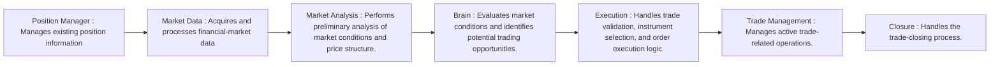

# E0 Price Engine

## 1. Project Introduction

**E0 Price Engine** is an independently developed, modular algorithmic trading and market analysis system designed for intraday trading in the Indian financial markets.

The project focuses on combining financial-market analysis, systematic rule based trading logic, and software engineering to develop an automated trading system.

E0 is being developed using Python, with NumPy and Numba for numerical computation and performance optimization, alongside financial-market APIs for market data acquisition and broker integration.

The project is independently designed and developed as a personal technical project.

E0 doesn't simply analyze candles; it evaluates the market behaviour reflected through price action.

---

## 2. Project Objectives

The primary objectives of E0 are:

* Develop a modular architecture for systematic intraday trading.
* Analyze financial-market data to identify relevant market structures and price zones.
* Identify potential trading setups using predefined analytical conditions.
* Identify market conditions and trading sessions unsuitable for participation.
* Automate entry identification and validation.
* Integrate market data and broker APIs.
* Identify and validate trendlines for entry analysis.
* Select suitable option contracts based on market conditions and predefined selection criteria.
* Calculate trade quantities based on execution and risk parameters.
* Implement structured execution and trade-management workflows.
* Maintain controlled risk-management and validation mechanisms.

---

## 3. Design Philosophy

E0 follows a principle of selective participation rather than continuous market activity.

Its objective is not to predict every market movement, but to evaluate market conditions, identify potential opportunities, and act only when predefined analytical conditions are satisfied.

The system emphasizes:

- Objective market judgment over prediction.
- Selective trade participation.
- Patience and disciplined execution.
- Confirmation before action.
- Continuous evaluation of changing market conditions.

E0 is designed to remain inactive when its predefined conditions for participation are not satisfied.

---

## 4. Strategy Framework and Scope — V1.0

E0 V1.0 implements a relatively simple, rule-based intraday reversal strategy developed through years of market observation and repeated historical backtesting.

The strategy focuses on identifying specific market conditions that may indicate potential directional reversals. It uses predefined analytical rules and confirmation conditions to evaluate trading opportunities.

**Strategy Scope:**

* The current V1.0 implementation is based exclusively on NIFTY 50 market behaviour as its analytical reference.
* The strategy follows a reversal-oriented trading approach.
* Trading opportunities are evaluated using predefined market-analysis and entry-validation conditions.
* The system emphasizes selective participation rather than attempting to capture every market movement.

**Distinction from the Broader Trading Methodology:**

The V1.0 strategy represents an initial, simplified implementation and does not incorporate the developer's complete trading methodology.

The broader methodology involves additional analytical concepts, including wick rejection, previous-day market psychology, global market sentiment, and multiple layers of market confirmation.

These concepts are not part of the current V1.0 strategy implementation.

The purpose of V1.0 is to establish a functional, rule-based trading system with a clearly defined strategy scope, providing a foundation for evaluating its individual components and overall behaviour.

---

## 5. Market Behaviour Analysis

E0 follows a behaviour-oriented approach to financial-market analysis.

Rather than relying exclusively on individual candlestick patterns or technical indicators, its analytical approach interprets market psychology through price action across multiple timeframes.

E0 attempts to identify such situations by evaluating:

* **Market Structure:** Identifying structural price movements, swing formations, macro trend, and changes in market direction.
* **Price Action:** Evaluating price movements, candle formations, retracements, and directional behaviour.
* **Multi-Timeframe Analysis:** Examining price behaviour across different timeframes to establish broader market context and identify potential trading opportunities.
* **Confirmation-Based Evaluation:** Waiting for predefined price-action conditions to confirm a potential opportunity before proceeding towards execution.

The objective is to distinguish meaningful market opportunities from ordinary price fluctuations.

---

## 6. System Architecture

E0 follows a modular architecture in which individual components perform specific responsibilities.

The high-level execution workflow is illustrated below:

Each component contributes to a specific stage of the trading process.

The architecture is designed to maintain separation of responsibilities, modularity, and independent development of individual components.

---

## 7. Intelligence and Execution Separation

E0 follows a strict separation between its analytical intelligence and execution components.

The Intelligence layer evaluates market conditions, analyzes price structures, calculate potential market zones, identifies potential trading setups, and validates entry opportunities.

The Execution layer handles expiry and strike price selection, execution validation, order-related operations, and trade management.

This separation is intended to maintain modularity, reduce coupling between analytical and execution components, and allow individual components to be developed and maintained independently.

---

## 8. Technology Stack

┌───────────────────────────────────────────────────────────────────────────────┐
| Technology | Application                                                      |
| ---------- | ---------------------------------------------------------------- |
| Python     | Core programming language                                        |
| NumPy      | Numerical operations and data processing                         |
| Numba      | Just-in-time compilation and computational optimization          |
| FYERS API  | Market data acquisition and financial-market integration         |
| Dhan API   | Broker integration and order execution                           |
| WebSockets | Real-time market-data communication                              |
| Git        | Version control                                                  |
| GitHub     | Repository hosting and documentation                             |
└───────────────────────────────────────────────────────────────────────────────┘
---

## 9. Financial-Market Domain

The project focuses on the Indian financial markets, particularly:

* NIFTY 50
* Intraday market structure.
* Support and resistance analysis.
* Trend identification.
* Price-action-based trading setups.
* Equity derivatives and options.
* Systematic risk management.

The analytical components combine financial-market concepts with programmatic logic to evaluate potential trading opportunities.

---

## 10. Development Approach

E0 is being developed using a modular and incremental approach.

The development process emphasizes:

* Separation of responsibilities between modules.
* Structured data processing.
* Rule-based market analysis.
* Computational efficiency.
* Error handling and validation.
* Historical testing and paper-trading evaluation.

Individual components are developed and evaluated before being integrated into the broader system.

---

## 11. Project Status

**Current Status: Under Development**

E0 is an ongoing independent development project.

The system is being developed incrementally, with emphasis on completing individual components, integration, error handling, and testing.

The current development focus is on execution-related components and system-level validation.

Real-money trading is not part of the current testing plan.

---

## 12. Repository Information

This is the public documentation repository for E0.

The actual implementation and proprietary Python source code are maintained separately in a private repository.

This public repository is intended to provide an overview of the project's architecture, technical design, development approach, and functional components without exposing proprietary implementation details.

---

## 13. Disclaimer

E0 is an independent personal development project intended for technical research, financial-market analysis, and algorithmic trading system development.

This project is not an investment advisory service and does not provide investment recommendations.

Nothing in this repository should be interpreted as a guarantee of trading performance or profitability.

The documentation describes the project's design and development. Actual system capabilities and implementation status may evolve as development progresses.
